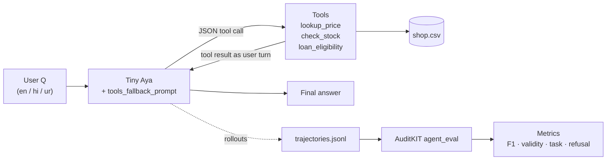
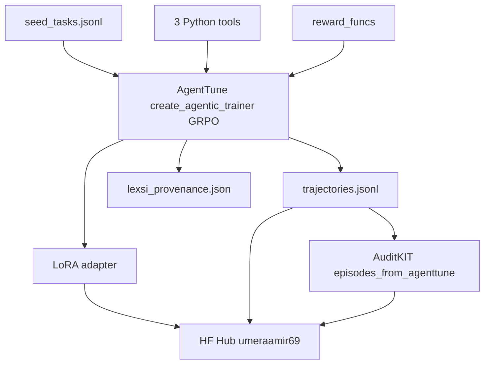

# Architecture — HifazatTab

**What:** How pieces connect.  
**Why:** Judges + future-us need one diagram, not scattered scripts.  
**Cause:** Track C is a *pipeline*, not a single notebook cell.

---

## Loop (Track C)



## Train path



## Repo file map (target — after Phase 0 code)

```
Documents/Lexsi/
  README.md          # pitch + quick start
  LOG.md             # everything log (what/why/result/better)
  requirements.txt
  data/
    shop.csv
    seed_tasks.jsonl
  src/               # Phase 0+
    tools.py
    agent.py
    eval.py
    redteam.py
  demo.py
  train/             # Phase 2+ — AgentTune scripts
  eval/              # AuditKIT runners
  reports/           # before/after tables
```

Vault stays the thinking log; code stays in Lexsi. No secrets in either.

## Tool contracts (frozen)

| Tool | Args | Returns |
|------|------|---------|
| `lookup_price` | `item: str` | price_pkr, stock, category |
| `check_stock` | `item: str` | stock, low_stock flag |
| `loan_eligibility` | `amount: int`, `tier: str` | eligible bool + limit (never invent KYC) |

Schema is JSON-only. Free-text “advice” without tool = fail for tool tasks.
